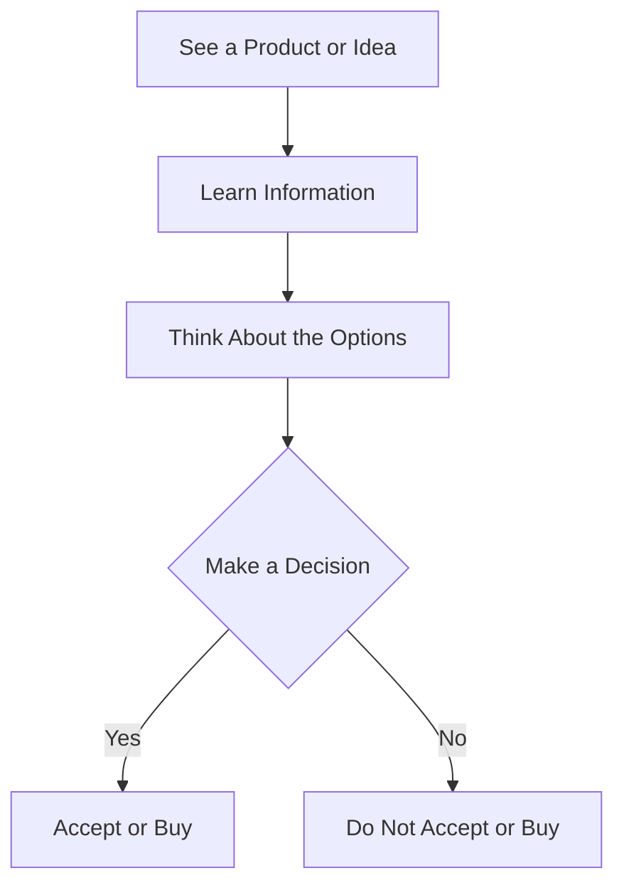

# Persuasion and Human Decision-Making

## What Is Persuasion?

Persuasion means trying to help someone understand an idea and possibly change their decision. We use persuasion every day when we recommend a product, explain our opinion, or try to convince someone to do something.

## Persuasion vs. Manipulation

Persuasion and manipulation are different. Persuasion gives people honest information and allows them to make their own choice. Manipulation tries to control someone's decision by hiding information, lying, or using unfair pressure.

Ethical persuasion should respect the other person's freedom to say yes or no.

## Cialdini's Principles of Influence

Robert Cialdini explained several principles that can influence people's decisions:

1. **Reciprocity** – People often want to return a favor when someone does something for them.
2. **Commitment and Consistency** – People usually want their actions to match choices they already made.
3. **Social Proof** – People often look at what other people are doing before making a decision.
4. **Authority** – People are more likely to trust advice from someone they see as an expert.
5. **Liking** – People are more easily persuaded by people they like or relate to.
6. **Scarcity** – Something can seem more valuable when it is limited or hard to get.
7. **Unity** – People can be influenced by someone they feel shares their identity or group.

## Other Ideas That Affect Decisions

### Framing Effect

The framing effect means that the way information is presented can change how people think about it. For example, saying "90% of customers are satisfied" may sound better than saying "10% of customers are not satisfied," even though both statements give the same information.

### Loss Aversion

Loss aversion means people often care more about avoiding a loss than getting an equal gain. For example, a customer may react more strongly to "Don't lose your $20 discount" than "Get a $20 discount."

## Example: Selling a Plain White T-Shirt

The same plain white T-shirt can be presented in different ways.

| Presentation | Example |
|---|---|
| Basic | "Plain white T-shirt for $20." |
| Social Proof | "One of our most popular T-shirts." |
| Scarcity | "Only a few left in stock." |
| Authority | "Made with high-quality cotton recommended for everyday wear." |
| Loss Aversion | "Buy today so you don't miss the sale price." |

These examples show how the same product can sound different depending on how the information is presented.

## Ethical Warnings

Persuasion should be honest and respectful. It should not trick people or hide important information.

- Do not lie about a product or idea.
- Do not use fake reviews or fake social proof.
- Do not create false scarcity.
- Do not pressure someone who has already said no.
- Give people enough information to make their own decision.

## Persuasion vs. Manipulation Comparison

| Persuasion | Manipulation |
|---|---|
| Gives honest information | May hide important information |
| Respects people's choices | Tries to control people's choices |
| Allows someone to say no | May use unfair pressure |
| Focuses on helping someone decide | Focuses on getting the desired result |

## Simple Decision Journey

## Questions to Ask Before Trying to Persuade

Before trying to persuade someone, ask yourself:

- Is the information I am giving honest?
- Am I respecting the person's freedom to choose?
- Am I explaining both the benefits and important risks?
- Am I using pressure or trying to scare the person?
- Would I be comfortable if someone used this method on me?

## Conclusion

Persuasion is part of everyday life. It can help people understand ideas, products, and choices. Good persuasion should use honest information and respect people's freedom to make their own decisions. Understanding these techniques can also help us recognize when someone is trying to influence us.