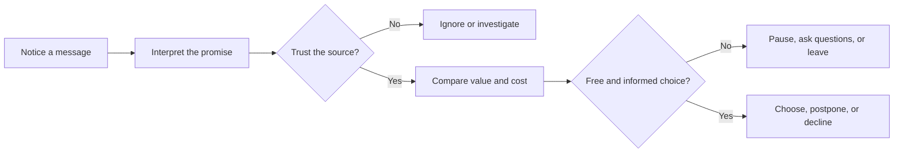

# Chapter 1 — Persuasion and Human Decision-Making

Persuasion is part of almost every designed experience. A headline persuades us to keep reading. A product page persuades us that an object is worth our money. A sign persuades us where to walk. Even a quiet, minimal layout makes an argument about what deserves our attention.

## What Is Persuasion?

In plain language, **persuasion is the process of helping shape another person's attention, interpretation, trust, or action through communication**. It can involve words, images, arrangement, timing, evidence, emotion, or a combination of these.

Persuasion does not guarantee a particular result. It creates conditions in which someone may understand an idea, see a possibility, or choose an action. The person still needs room to think and decide.

Consider a plain white T-shirt. The shirt itself has not changed, but its presentation can guide interpretation:

- “A dependable cotton basic for everyday wear” emphasizes usefulness.
- “A clean starting point for your own style” emphasizes freedom and self-expression.
- “A limited studio run” emphasizes rarity and collecting.

These are different persuasive frames around the same physical object. Ethical persuasion keeps the description truthful and lets the audience make a meaningful choice.

## Persuasion, Manipulation, and Coercion

Persuasion and manipulation can look similar because both try to influence a decision. The important difference is how the influence treats the other person.

| Approach | How it works | What it does to the person's choice |
| --- | --- | --- |
| Persuasion | Offers understandable reasons, evidence, and a clear value | Supports an informed choice |
| Manipulation | Hides important information, exploits a vulnerability, or creates a misleading impression | Makes the choice less informed |
| Coercion | Uses threats, force, or punishment to remove realistic alternatives | Replaces choice with pressure |

For example, a T-shirt seller can honestly say that only a small number were produced if that is true. Showing a fake countdown timer to make people panic is manipulation. Threatening a customer with a penalty for not buying is coercion. Persuasive design should make the value legible, not make refusal feel impossible.

## Cialdini's Principles of Influence

Robert Cialdini's work is commonly introduced through seven principles of influence. These principles describe patterns that often affect how people respond to requests and messages. They are not buttons that guarantee compliance, and using them responsibly requires attention to context and truthfulness.

1. **Reciprocity:** People often feel inclined to return a useful favor. A clothing company might offer a genuinely useful sizing guide before asking someone to shop.
2. **Commitment and consistency:** After making a choice or stating a position, people often prefer actions that fit it. A customer who chooses durable, repairable products may be interested in a shirt with clear care information.
3. **Social proof:** When uncertain, people look at what others appear to be doing. Honest reviews or a clearly explained number of satisfied customers can reduce uncertainty; invented reviews cannot.
4. **Liking:** People are more open to requests from sources they find relatable, familiar, or appealing. A brand can use a voice that respects its audience rather than pretending to share an identity it does not understand.
5. **Authority:** Expertise and credible evidence can help people judge quality. A qualified textile specialist explaining fabric construction is more useful than an unsupported “expert choice” label.
6. **Scarcity:** Limited availability can make an opportunity seem more valuable. A real production limit can be stated clearly, but false scarcity turns urgency into deception.
7. **Unity:** People respond to a sense of shared identity or belonging. A company might invite customers into a community organized around repair and reuse, rather than using identity language to exclude or shame people.

### Principle, Mechanism, and Risk

| Principle | Mechanism | Ethical use | Misuse risk |
| --- | --- | --- | --- |
| Reciprocity | A helpful gift can create a desire to respond | Give useful information with no hidden obligation | A “free” offer that conceals an unwanted charge |
| Commitment and consistency | People tend to align later actions with earlier choices | Help someone set a goal they freely chose | Trapping someone with an embarrassing public commitment |
| Social proof | Other people's behavior reduces uncertainty | Use real, representative reviews | Fake reviews or misleading popularity claims |
| Liking | Familiarity and rapport increase openness | Use a respectful, audience-aware voice | Manufactured intimacy or false shared identity |
| Authority | Credible expertise signals reliability | Identify relevant qualifications and evidence | Borrowed credentials or vague expert claims |
| Scarcity | Limited access can increase perceived value | State a real limit and its reason | Fake countdowns, hidden inventory, or panic tactics |
| Unity | Shared identity can create belonging | Support a genuine community and its values | Exclusion, stereotyping, or identity-based pressure |

## Other Useful Ways to Understand Decisions

### Framing

**Framing** means presenting the same information through a particular angle. A frame does not necessarily change the facts, but it changes which facts feel most important. “Keeps its shape after repeated washing” frames a T-shirt around durability. “A blank canvas for your wardrobe” frames it around possibility.

Good framing clarifies a relevant benefit without hiding a relevant limitation. A designer should ask what the frame helps the audience notice and what it might cause them to overlook.

### Loss Aversion and Defaults

Behavioral economics often examines how people make decisions that are not perfectly calculating. **Loss aversion** is the tendency for a possible loss to feel more powerful than an equivalent gain. “Avoid replacing another shirt next year” may motivate a purchase differently from “Get one more shirt.” Either message should be supported by a reasonable, honest claim.

A **default** is the option someone receives unless they actively change it. A checkout box that adds a newsletter by default may increase subscriptions, but it does so at the cost of clarity if people miss it. An ethical default is easy to understand, easy to change, and not designed to exploit inattention.

### Rhetorical Appeals

Rhetoric offers another useful lens:

- **Ethos** concerns credibility: Why should the audience trust this speaker or organization?
- **Logos** concerns reasoning and evidence: What facts or connections support the claim?
- **Pathos** concerns emotion: What feeling helps the audience care about the issue?

A responsible T-shirt message might combine all three: a transparent maker explains the construction (ethos), gives accurate material and care information (logos), and shows the pleasure of wearing a reliable favorite (pathos). Emotion is not automatically manipulation; the problem is using emotion to replace or obscure the information a person needs.

## A Simple Decision Journey

People do not always move through decisions in a neat order, but a designer can use this simplified journey to notice where persuasion is happening:

At each stage, design affects what is easy to notice and understand. Ethical practice also protects the “no” paths. A person should be able to pause, investigate, postpone, or decline without being tricked or punished.

## Questions to Ask Before Trying to Persuade

1. What do I want the audience to understand, feel, or do?
2. Is my central claim accurate, specific, and supported by what I know?
3. What important limitation or cost would a reasonable person need to see?
4. Am I helping someone decide, or am I trying to bypass their judgment?
5. Does the audience have a genuine way to say no, leave, or change their mind?
6. Which principle or emotional appeal am I using, and what could go wrong?
7. Would I accept this message if I were the person receiving it?

## The White T-Shirt Example

Imagine three stores selling the same plain white T-shirt. Store A photographs it folded beside a care label and emphasizes dependable construction. Store B shows it under a bold jacket and describes it as a flexible base for personal style. Store C presents it in a sparse display with a numbered production note and focuses on limited availability.

The shirt has not changed. The context changes its meaning by directing attention toward reliability, self-expression, or rarity. That is the power of persuasion in branding and design. It is also why designers have a responsibility to keep the frame connected to reality. A basic shirt can be made meaningful without pretending it is something it is not.

## Explore Further

To research this chapter, search for:

- Robert Cialdini's principles of influence and later revisions to the framework
- framing effects and loss aversion in behavioral economics
- dark patterns and ethical persuasive design
- ethos, logos, and pathos in introductory rhetoric
- defaults, choice architecture, and informed consent

Use reliable academic, library, or professional sources and compare claims rather than treating one summary as final authority.

## What You Should Remember

Persuasion shapes attention, interpretation, trust, and action. It is different from manipulation because it respects informed choice, and different from coercion because it leaves room to refuse. Cialdini's principles, framing, behavioral economics, and rhetoric help explain why messages work. The ethical test is simple but demanding: make the value clear, keep the claims truthful, reveal meaningful limits, and leave the decision genuinely with the person.