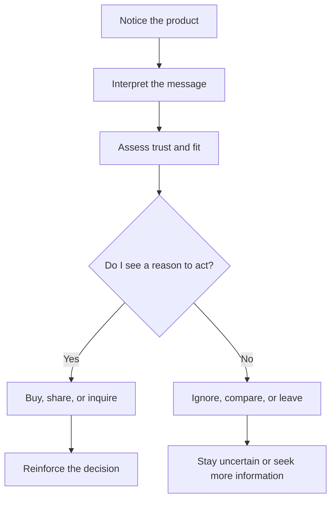

# Chapter 1: Persuasion, Trust, and the Shape of Attention

Persuasion is sometimes treated as a dirty word, as if it means pressure, tricks, or manipulation. In reality, persuasion is a basic part of human life. We persuade each other all the time when we explain a decision, recommend a product, encourage a friend, or help someone understand a new idea.

At its best, persuasion is not about forcing people to do something. It is about helping shape attention, interpretation, trust, and action. A person sees a problem, a product, or an opportunity in a certain way. Persuasion can influence which details they notice, how they interpret them, whether they trust the message, and whether they decide to act.

That makes persuasion relevant to design, branding, and communication. Designers do not just make things look attractive. They often help people decide what a thing means.

## A plain white T-shirt: the same object, different stories

Consider a plain white T-shirt. It is just cotton, dye, stitching, and a basic silhouette. Yet the same shirt can be framed in many different ways:

- as a “premium essential” for a minimalist wardrobe
- as a “performance tech shirt” for athletes and commuters
- as a “canvas for self-expression” for artists or students
- as a status item from an elite streetwear brand
- as a sustainable, ethically made garment

The shirt has not changed. The meaning changes because the message changes. That is the heart of persuasion: not changing the object itself, but changing the interpretation around it.

A designer is often not selling a product in isolation. They are helping people answer questions like:

- Why should I care?
- Why should I trust this?
- What does this say about me?
- What happens if I do not act?

These are persuasion questions.

## Persuasion is not coercion or manipulation

A useful distinction is this:

- Persuasion invites, frames, and clarifies.
- Coercion uses threat, force, or pressure to bypass choice.
- Manipulation hides the real intent, exploits vulnerability, or uses tricks to distort judgment.

Persuasion is not always morally neutral. It can be ethical or unethical depending on intent, honesty, and respect for autonomy. A persuasive message that is transparent, relevant, and built on truthful information is different from one that exploits fear, confusion, or dependence.

A good rule: persuasion should help someone make a more informed decision, not make them less free.

If a person is genuinely informed, emotionally respected, and not deceived, persuasion can be a tool for communication and choice. If the person is pressured, misled, or manipulated into acting against their own interests, that is a different problem.

## Why persuasion matters in design

Designers are not just arranging pixels or choosing colors. They are shaping how people interpret information and how they decide what matters. This is especially obvious in branding, product marketing, and digital interfaces.

In a design context, persuasion usually works through four linked stages:

1. Attention: What gets noticed?
2. Interpretation: What does it mean?
3. Trust: Why should I believe it?
4. Action: What do I do next?

A good message does not simply shout louder. It helps people understand why the message matters to them.

## Robert Cialdini's major principles of influence

Robert Cialdini is often cited because he identified patterns that repeatedly show up in human decision-making. His principles are useful, though they are not magic rules. They are better thought of as patterns that become persuasive when used with honesty and good judgment.

| Principle | How it works | Ethical use | Misuse risk |
| --- | --- | --- | --- |
| Reciprocity | People feel obliged to return favors or kindness. | Offer value first: useful information, a free sample, a helpful service. | Guilt-based pressure or manipulative “you owe me” messaging. |
| Commitment and consistency | People prefer to act in ways that match what they have already said or done. | Help people make small, public commitments that align with their values. | Trapping people into decisions they did not fully understand. |
| Social proof | People look to others to judge what is normal, wise, or desirable. | Show genuine community feedback, testimonials, or examples of use. | Fake reviews, misleading popularity, herd pressure. |
| Authority | People are more likely to trust expertise and status. | State credentials, experience, and reasoning clearly. | Using fake expertise or charisma to bypass real judgment. |
| Liking | People respond more positively to those they feel connected to, similar to, or comfortable with. | Build rapport and clarity; present genuinely relatable value. | Flattery, false familiarity, or emotional manipulation. |
| Scarcity | People value things more when they believe they are limited or time-sensitive. | Communicate real constraints honestly and clearly. | Artificial urgency, fear-based pressure, or false scarcity. |

Here is how that might look with a T-shirt example:

- Reciprocity: a brand offers a free sizing guide or a small gift with purchase, which makes the buyer feel more positively toward the brand.
- Commitment and consistency: a customer who says “I care about sustainable basics” is more likely to buy a shirt that matches that identity.
- Social proof: a shopper sees a large number of positive reviews or sees how other people style the item.
- Authority: a fashion editor or product expert explains why the fabric and fit are worth paying attention to.
- Liking: the brand seems warm, relatable, and consistent with the shopper’s tastes.
- Scarcity: “limited run” or “only a few left in this color” can increase urgency, but it must be genuine.

## Beyond Cialdini: other useful ideas

Cialdini gives a strong starter set, but persuasion is broader than six principles. Several other ideas from psychology, rhetoric, and behavioral economics are especially useful.

### 1. Framing and loss aversion

People often respond less to the positive value of something than to the feeling of losing it. This is often called loss aversion: the pain of losing something feels stronger than the pleasure of gaining something similar.

A plain white T-shirt can be framed in different ways:

- “Made for everyday comfort” emphasizes benefit.
- “Limited to this season” emphasizes potential loss.
- “This is the shirt you will regret not buying later” relies on future regret.

Designers often use framing to make options easier to compare. But framing can become ethically slippery when it hides the real tradeoff or amplifies fear without providing useful information.

### 2. Cognitive dissonance and self-concept

People dislike inconsistency. If they already think of themselves as someone who values quality, practicality, or originality, they may feel uncomfortable if their behavior does not match that self-image.

A T-shirt can support identity in ways that are not purely functional. A brand can say:

- “This is for people who want fewer, better things.”
- “This is for people who dress simply but with intention.”
- “This is the shirt you keep reaching for.”

Those messages do not just sell material. They help the buyer fit a story about themselves and feel consistent with it.

### 3. Ethos, pathos, and logos

Classic rhetoric gives another useful lens. People are persuaded by:

- Ethos: credibility and trustworthiness
- Pathos: emotion and identification
- Logos: reason and evidence

A designer may use all three at once, or emphasize one more than the others depending on the audience. A T-shirt brand that emphasizes “made in a small studio” is leaning on ethos. A campaign about comfort and self-expression uses pathos. A product page that explains fabric weight, fit, and durability uses logos.

The best persuasive communication often combines all three rather than relying on one alone.

## A simple decision journey

This diagram is deliberately simple. Real decisions are more complicated, but it shows the emotional and cognitive path that persuasion tries to influence. A strong design does not just attract attention; it helps a person move from curiosity to trust to action.

## Ethical cautions

Persuasion becomes ethically concerning when it exploits vulnerability rather than respects agency. Designers should be careful about:

- fear-based messaging that overwhelms a person’s ability to think clearly
- false urgency that creates panic rather than informed choice
- hidden motives that make the product seem more valuable than it is
- using shame, insecurity, or dependency as a lever
- presenting biased or incomplete information as full truth

A persuasive design is not necessarily a manipulative one. But the line is easy to cross if a designer cares more about conversion than clarity.

The more a product is framed around identity, status, or emotional need, the more important honesty becomes. People do not just buy a shirt; they often buy a story about who they are or who they want to become.

## Questions to Ask Before Trying to Persuade

Before designing a persuasive message, a thoughtful designer should ask:

- What problem am I actually helping someone solve?
- Am I describing the real value, or am I creating a distorted story?
- Who is the audience, and what do they already believe?
- What do I want them to notice, and what am I leaving out?
- Am I building trust, or am I relying on pressure?
- Is this message truthful, specific, and respectful?
- Am I persuading with evidence, or only with emotion?
- What happens if the person says no?
- Does this product or message respect the person’s autonomy?
- Will the person still feel okay about their decision later?

These questions matter because persuasion is most effective when it is grounded in clarity and respect, not deception.

## The same white T-shirt, different persuasion strategies

This is where the recurring example becomes useful. The shirt itself remains the same, but the persuasive framing can shift dramatically.

### Option 1: The practical shirt

A brand tells a customer: “Made from strong cotton, cut for everyday wear, built for comfort.”

This message emphasizes usefulness. It appeals to logic and everyday value. It is likely to persuade someone who wants a reliable basic.

### Option 2: The status shirt

A brand tells a customer: “A limited edition staple worn by people who care about taste and restraint.”

Now the shirt is not just cotton; it is a marker of taste, identity, and social belonging. This message appeals to status, social proof, and identity.

### Option 3: The ethical shirt

A brand tells a customer: “Thoughtfully made, small-batch, produced with care and transparency.”

This message appeals to trust, values, and responsibility. It may persuade someone who wants to support ethical consumption and reduce confusion about supply chains.

### Option 4: The expressive shirt

A brand tells a customer: “Your blank canvas. Wear your ideas. Make it yours.”

This message shifts from product to self-expression. It emphasizes identity, creativity, and personalization. It invites action by making the shirt part of a valued personal story.

The idea is simple: the product does not change, but the meaning does. Persuasion is often about telling a more convincing story about what a thing already is.

## Explore Further

If you want to expand your reading beyond this chapter, useful search suggestions include:

- Cialdini principles of influence explained
- framing effects in decision making
- loss aversion examples in marketing
- cognitive dissonance and buying behavior
- ethos pathos logos in advertising
- ethical persuasion in design and communication
- choice architecture and nudging
- how branding shapes product meaning

These topics are worth exploring, especially because they show how everyday decisions are influenced by context, language, and identity.

## What You Should Remember

- Persuasion is the process of shaping attention, interpretation, trust, and action.
- It is different from coercion and manipulation because it aims to inform and invite rather than pressure or deceive.
- Cialdini’s principles—reciprocity, commitment, social proof, authority, liking, and scarcity—are useful patterns, but they must be used honestly.
- Other useful ideas include framing, loss aversion, cognitive dissonance, and rhetorical appeals.
- The same plain white T-shirt can be sold as a practical object, a status symbol, an ethical product, or a form of self-expression without changing the shirt itself.
- Good persuasion respects the audience and helps them decide with clarity, not confusion.

Persuasion is not a trick. It is a way of understanding how people decide and how communication can make a better decision easier to make.
