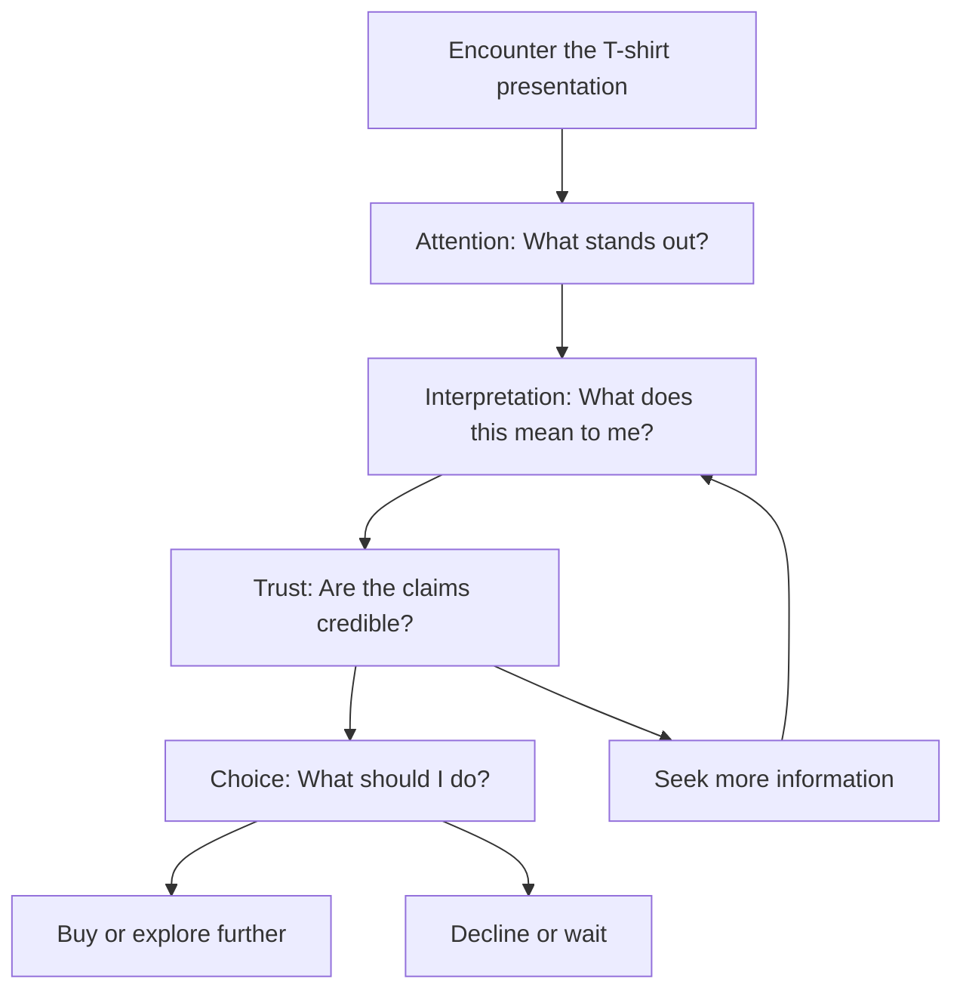

# Chapter 1: Persuasion — Helping People See a Reason to Act

Imagine a plain white T-shirt on a table. No logo, no slogan, no dramatic packaging. Now imagine three photographs of that same shirt: paired with everyday jeans, arranged in a carefully edited wardrobe, and worn by members of a campus club.

The fabric has not changed. The invitation has. You might see a practical basic, a deliberate style choice, or a way to belong.

That gap between an object and what it means to someone is where persuasion enters design. All T-shirt campaigns in this chapter are hypothetical examples, not reports about real brands or research findings.

## What Persuasion Does

**Persuasion is communication intended to influence how someone thinks, feels, or chooses.** It can offer reasons, evoke emotions, or make one feature more noticeable. It is useful for selling shirts, but also for explaining a public service, inviting participation, or helping someone understand an unfamiliar idea.

For a designer, persuasion can help shape four things:

- **Attention:** What gets noticed? A close-up draws attention to the shirt; a large price label draws attention to cost.
- **Interpretation:** What does it mean? The headline “Start with a simple foundation” presents plainness as versatility.
- **Trust:** Why believe the message? Accurate measurements and clear return terms give a shopper something to evaluate.
- **Action:** What happens next? A visible “View sizes” button offers a manageable next step.

These are connected, but they are not a guaranteed sequence. Someone can notice an advertisement, understand it, trust it, and still decide that they already own enough shirts.

Treat this diagram as a planning aid, not a scientific model of every decision. Its most important feature is that declining remains a legitimate outcome.

## Persuasion, Manipulation, and Coercion

Influence is not automatically ethical. A useful distinction is whether the communication supports a person's ability to make an informed, voluntary choice.

- **Persuasion** offers reasons, meanings, or emotional appeals that someone can evaluate. Showing three ways to style the shirt and clearly stating its price lets the person understand the offer and refuse.

- **Manipulation** misleads, hides important information, or exploits vulnerabilities to steer a decision. A countdown that resets every time the page opens distorts the choice by creating a false impression of urgency.

- **Coercion** uses force or a credible threat to compel compliance. If a supervisor threatens to cut someone's shifts unless they buy the shirt, refusal carries a threatened penalty.

These categories can overlap. Manipulation can be a deceptive form of persuasion; coercion can come wrapped in friendly language. A technically available “No” button does not make an experience fair if costs are hidden or refusal is deliberately confusing.

Emotion itself is not the problem. A joyful photograph can communicate a real possibility. The problem is using that feeling to conceal facts or undermine the person's judgment.

## Cialdini's Principles of Influence

Robert Cialdini's framework originally included six principles; the expanded framework adds unity. Here are the seven in brief. See [Cialdini's overview at Influence at Work](https://www.influenceatwork.com/7-principles-of-persuasion/).

- **Reciprocity:** Receiving something can encourage us to give back. Offer a useful, freely available styling guide.

- **Commitment and consistency:** We tend to act consistently with earlier voluntary commitments. Connect the shirt to a shopper's stated preference for simple outfits.

- **Social proof:** Others' behavior can guide us, especially under uncertainty. Display genuine customer reviews.

- **Authority:** Relevant expertise can increase credibility. Include a qualified textile expert's actual assessment.

- **Liking:** We are more receptive to people we like. Use an approachable presenter with shared interests.

- **Scarcity:** Limited availability can increase desirability. Show accurate remaining stock.

- **Unity:** A shared identity can make influence stronger. Present the shirt within a real campus community.

These are tendencies, not guarantees. Unity concerns shared group identity; liking concerns personal affinity. Neither proves product quality.

An ethical application needs more than a persuasive cue. A free guide should not create a hidden obligation. A previous preference should not trap someone into a purchase. Reviews must be authentic, expertise relevant, stock counts accurate, and community membership more than a fabricated sales story. Customers must be allowed to change their minds.

## Beyond the Principles: Framing

**Framing** concerns how a choice is presented and which aspects become prominent. Amos Tversky and Daniel Kahneman showed that different presentations of decision problems can shift preferences. That does not mean every wording change will work, or that people will respond identically. See their paper, [“The Framing of Decisions and the Psychology of Choice”](https://doi.org/10.1126/Science.7455683).

For design, this raises a practical question: which interpretation does the presentation invite? Consider these possible campaigns. Hold the shirt and its price constant; change only the words, images, and setting.

- **Everyday utility — “One simple starting point.”** Show the shirt with several everyday outfits to emphasize practical versatility.

- **Deliberate style — “Make room for simplicity.”** Use a spacious layout and a restrained wardrobe photograph to emphasize intentional personal taste.

- **Shared identity — “Different people. One shared look.”** Show consenting club members wearing the shirt to emphasize participation and belonging.

- **Creative possibility — “Your next idea starts here.”** Place the unchanged shirt beside drawing materials to suggest a possible canvas for self-expression.

These are proposed frames, not experimentally verified outcomes. Different audiences might read the same layout differently. One person's elegant simplicity might look boring to someone else.

Framing selects emphasis; it cannot supply missing evidence. A refined photograph does not establish superior fabric. A green background does not establish sustainable manufacturing. You can change the story around the shirt without changing the shirt, but you cannot honestly invent its properties.

## Beyond the Principles: Reference Points and Loss Aversion

People often evaluate outcomes relative to a **reference point**, such as what they own or expect. **Loss aversion** describes the tendency for losses to weigh more heavily than comparable gains. It is not a rule that everyone always fears losses or that every loss has a fixed psychological multiplier. Kahneman discusses these ideas in his [Nobel autobiography](https://www.nobelprize.org/prizes/economic-sciences/2002/kahneman/biographical/?vid=330).

Imagine a shopper already has a favorite white T-shirt. A new shirt may offer another outfit option, but buying it also means giving up money. The designer should understand that tradeoff rather than assume that adding benefits will settle the decision.

A message such as “Don't lose your chance” tries to emphasize a possible loss. Whether it actually produces loss aversion in this situation would need investigation. Scarcity and loss aversion are related but distinct: scarcity concerns limited availability; loss aversion concerns how losses and gains are evaluated relative to a reference point.

Use this concept to understand hesitation, not to manufacture anxiety. Explain the full price, fit, and return conditions. Do not invent a deadline or imply that refusing a shirt means losing social acceptance.

## Questions to Ask Before You Persuade

Before choosing a headline, photograph, or button, ask:

1. **Whose goal am I serving?** Does buying this shirt help the audience, or only the seller?
2. **What exactly am I asking someone to do?** Viewing sizes and committing to a purchase require different information.
3. **Which claims can I support?** Could I show evidence for reviews, materials, expertise, or availability?
4. **What might the design imply without saying it?** Could someone mistake styling for proof of quality or environmental responsibility?
5. **What does the person need to know?** Are total cost, sizing, and important conditions readable and easy to find?
6. **Can someone comfortably refuse or reconsider?** Avoid shame, confusing exits, and unwanted commitments.
7. **Who might experience this differently?** Consider language, accessibility, financial pressure, and cultural interpretations.
8. **How would I judge success beyond purchases?** Understanding, satisfaction, and fewer mistaken orders matter too.

A useful ethical check is to describe the design strategy openly. “We showed several outfits to explain versatility” is easy to defend. “We made people think their friends would reject them without it” should prompt a redesign.

## Explore Further

These are suggestions for external research, not additional claims established by this chapter. Search a library catalog or scholarly search service for:

- **“Robert Cialdini seven principles unity”** — compare the original six principles with the expanded framework.
- **“Tversky Kahneman framing of decisions psychology of choice”** — examine what the researchers actually compared.
- **“loss aversion reference dependence boundary conditions”** — investigate when the effect varies or weakens.
- **“ethical persuasive design deceptive patterns”** — look for examples of interfaces that support or undermine informed choice.

For each source, ask who produced it, what evidence it provides, and whether its findings apply to your audience and situation.

## What You Should Remember

- Persuasion can shape attention, interpretation, trust, and action while preserving meaningful choice.
- Cialdini's seven principles describe influence tendencies, not automatic formulas or ethical permission slips.
- Framing changes what a product means; it does not change or prove its physical qualities.
- Reference points and loss aversion help explain decisions, but their effects depend on context.
- The same white T-shirt can carry different stories. Responsible design keeps those stories honest and leaves room for “no.”
