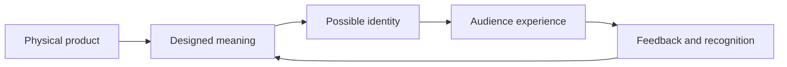

# Chapter 2: Brand Archetypes and Meaning

A product is never only a physical object. People also attach stories, expectations, and identities to it. A plain white T-shirt can mean practicality, independence, status, belonging, or possibility depending on how it is presented.

**Brand archetypes** are a practical framework for shaping those meanings. An archetype is a recognizable cultural and narrative pattern: the guide who helps people understand, the explorer who seeks freedom, or the caregiver who protects others. Archetypes help a designer make a brand feel coherent across images, words, products, and experiences.

The useful question is not “Which personality type is this customer?” It is:

> What does the audience get to feel, imagine, or become by choosing this brand?

## What an Archetype Does

An archetype gives a brand a point of view. It suggests what the brand notices, what it values, how it speaks, and what kind of story it invites the audience to join.

For example, a white T-shirt positioned through the **Sage** archetype might emphasize fabric facts, construction details, and thoughtful buying. The same shirt positioned through the **Rebel** archetype might emphasize refusing fashion rules and wearing an ordinary object in an unexpected way. The product is identical; the meaning around it changes.

Archetypes can help coordinate decisions that might otherwise feel disconnected:

- **Visual language:** color, type, photography, composition, and materials
- **Voice:** vocabulary, rhythm, humor, seriousness, and point of view
- **Experience:** how customers are welcomed, guided, supported, and remembered
- **Story:** the tension, desire, or transformation the brand makes available

An archetype is most useful when it gives the audience a consistent experience rather than merely adding a label to a mood board.

## A Useful Set of Archetypes

The following twelve archetypes are common starting points. They are broad patterns, not complete descriptions of every brand.

| Archetype | Central desire | Audience may feel, imagine, or become | T-shirt expression |
| --- | --- | --- | --- |
| Explorer | Freedom and discovery | Independent, capable, ready for the unfamiliar | A durable shirt for changing places and unplanned days |
| Sage | Understanding and truth | Informed and thoughtful | A carefully documented shirt with clear material and care information |
| Creator | Making something original | Expressive and inventive | A blank canvas for customization, styling, or screen printing |
| Ruler | Order and excellence | In control and discerning | A precise, well-finished essential presented with quiet authority |
| Caregiver | Protection and support | Cared for and able to care for others | A comfortable, dependable shirt with inclusive fit guidance |
| Rebel | Freedom from stale rules | Defiant and self-directed | An ordinary shirt styled against expected fashion conventions |
| Hero | Courage and achievement | Strong, prepared, and able to make a difference | A reliable shirt connected to effort, training, or service |
| Everyperson | Belonging and equality | Welcome, understood, and part of the group | An accessible staple shown across ordinary shared moments |
| Innocent | Safety and optimism | Light, open, and unburdened | A bright, uncomplicated shirt associated with freshness and ease |
| Jester | Enjoyment and play | Amused, relaxed, and free to be silly | A simple shirt used as the setup for a visual joke or playful styling |
| Lover | Connection and appreciation | Attractive, present, and emotionally engaged | A tactile, close-up presentation focused on comfort and personal pleasure |
| Magician | Transformation and possibility | Able to see an ordinary thing differently | A familiar shirt reframed as the starting point for a new self-presentation |

These categories often overlap. An Explorer brand may use Creator methods. A Caregiver may need Sage-like evidence to prove that its promises are reliable. The table is a vocabulary for making choices, not a test with one correct answer.

## One Shirt, Three Very Different Stories

Imagine that the physical product is unchanged: a plain white T-shirt with the same fabric, cut, and price. Here are three dramatically different ways to position it.

### The Explorer: “Ready for What Is Next”

The shirt appears in a sequence of ordinary but changing settings: a train platform, a windy trail, and a late meal in an unfamiliar town. The copy emphasizes easy packing, repeated wear, and freedom from overplanning.

The audience is invited to feel mobile and capable. The shirt becomes less a fashion statement than a dependable companion. The design might use open compositions, natural light, direct language, and evidence about washability. The Explorer frame should not promise that a shirt can solve every travel problem; it should connect real product qualities to a larger desire for movement.

### The Creator: “Start With the Blank”

The shirt appears as a clean surface beside fabric markers, a sewing machine, or a set of digital pattern files. The presentation leaves room for variations rather than insisting on one finished look.

The audience is invited to imagine making something personal. The shirt becomes a material for experimentation. The design might use process photographs, flexible layouts, and examples that demonstrate possibilities without implying that every customer must be an artist.

### The Everyperson: “A Place to Begin Together”

The shirt appears on people of different ages and styles during an ordinary community activity. The message focuses on comfort, availability, clear sizing, and the ease of joining in.

The audience is invited to feel welcome rather than evaluated. The shirt becomes a shared starting point. The design might use warm but unsentimental photography, plain language, and practical information that reduces barriers to participation.

The shirt has not changed across these examples. The audience's imagined role has changed: traveler, maker, or participant. That imagined role is one of the main things a brand offers.

## From Product to Identity

Brand meaning often develops through a sequence. A product provides something concrete. Design gives that product an interpretation. The interpretation can become part of how someone describes themselves, especially when other people can see the choice.

For the white T-shirt, the physical product might be “a simple cotton garment.” Designed meaning turns it into “a tool for exploration,” “material for making,” or “a welcoming everyday uniform.” Possible identity lets a customer imagine being adventurous, creative, or included. The audience experience then tests whether the brand actually supports that identity. If the fit information is confusing or the shirt is uncomfortable, the promised meaning loses credibility.

## Archetypes Are Not Destiny

Archetypes are models, not literal personality diagnoses. They do not prove what a person is like, and they should not be used to sort people into fixed boxes. A person may be playful at home, analytical at work, protective with family, and adventurous on a trip. A brand may also contain multiple tendencies.

Cultural context matters. An image of authority, freedom, care, or rebellion can carry different associations in different communities and historical settings. A symbol that feels welcoming to one audience may feel exclusionary or unfamiliar to another. Designers need to test their assumptions with actual audience members instead of treating an archetype chart as universal psychology.

Archetypes also change over time. A brand can grow from a Rebel into a more Caregiver-oriented role, or combine Sage information with Creator energy. The combination should still make sense to the audience. The goal is not to perform every archetype at once; it is to choose a clear center of gravity while leaving room for complexity.

## Choosing an Archetype in Practice

Start with evidence rather than decoration. Look at what the organization actually does, what the product can credibly support, and what the audience is trying to accomplish. Then compare possible archetypes:

| Question | Explorer | Sage | Everyperson |
| --- | --- | --- | --- |
| What desire is foregrounded? | Freedom and discovery | Understanding and confidence | Belonging and ease |
| What should the audience imagine? | Going somewhere new | Making a well-informed choice | Joining without needing to perform |
| What proof would matter? | Durability and adaptability | Specific evidence and transparency | Access, comfort, and real inclusion |
| What could go wrong? | Treating ordinary life as inadequate | Sounding cold or superior | Flattening differences into a generic “everyone” |

This comparison makes an important distinction: an archetype is not just a visual style. It changes the claims a brand makes, the evidence it needs, and the risks it creates.

## Questions to Ask When Choosing an Archetype

1. What does the audience get to feel, imagine, or become by choosing this brand?
2. What real product or organizational behavior supports that promise?
3. Which archetype best describes the value we can consistently deliver?
4. Are we choosing this archetype because it fits the audience, or because its style is fashionable?
5. What other tendencies should support the central archetype without confusing the message?
6. How might this archetype be understood differently across cultures or communities?
7. What evidence would make the promise credible?
8. Who might feel excluded, stereotyped, or misrepresented by this framing?
9. Does the experience after choosing the brand match the identity we are inviting people to imagine?

## Concrete Design Exercise

Take the same product description: “plain white T-shirt, medium-weight cotton, machine washable.” Write one short product page for each of these archetypes:

- **Sage:** explain the materials, construction, care, and limits clearly.
- **Jester:** create a playful situation in which the shirt's simplicity becomes the joke.
- **Caregiver:** focus on comfort, fit support, durability, and making the purchase less stressful.

Then compare the pages. Which words changed? Which images did you choose? What did each version make easier to imagine? Finally, check whether every factual claim stayed the same. The point of the exercise is to distinguish a change in meaning from a change in the product itself.

## What You Should Remember

Brand archetypes are broad cultural and narrative patterns that help organize meaning; they are not rigid personality types. A brand can combine tendencies, and cultural context can change how an archetype is understood. The same white T-shirt can become a companion for an Explorer, material for a Creator, or a welcoming staple for the Everyperson. Choose an archetype by asking what the audience gets to feel, imagine, or become, then make sure the real experience can support that promise.