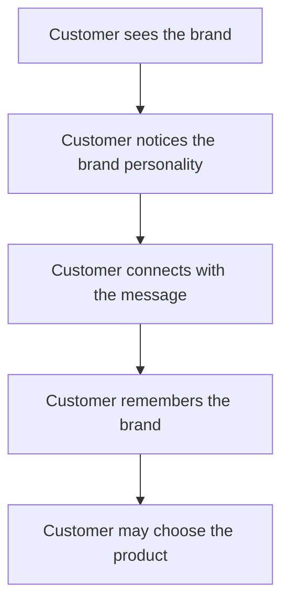

# Brand Archetypes and Meaning

## What Are Brand Archetypes?

Brand archetypes are personalities that companies use to help people understand their brand. They help a brand show what it believes in and how it wants customers to feel. For example, some brands want to feel adventurous, while others want to feel safe, creative, or powerful.

Brand archetypes are important because they help customers connect with a brand. When a company uses the same personality in its advertisements, products, and messages, customers can understand and remember the brand more easily.

## Common Brand Archetypes

| Archetype | Meaning | Example |
|---|---|---|
| Hero | Brave, strong, and wants to overcome challenges | Nike |
| Explorer | Loves freedom, adventure, and discovering new things | Jeep |
| Creator | Focuses on creativity and making something unique | LEGO |
| Caregiver | Wants to help, protect, and care for people | Johnson & Johnson |
| Jester | Fun, playful, and makes people happy | M&M's |
| Ruler | Represents control, leadership, and success | Rolex |
| Lover | Focuses on beauty, relationships, and emotions | Chanel |
| Sage | Focuses on knowledge, truth, and learning | Google |
| Innocent | Simple, positive, and optimistic | Dove |
| Outlaw | Breaks rules and challenges what is normal | Harley-Davidson |
| Magician | Creates exciting experiences and makes things feel possible | Disney |
| Everyman | Friendly, normal, and easy for everyone to relate to | IKEA |

## The Same White T-Shirt With Different Archetypes

A plain white T-shirt can be sold in different ways even if the product stays exactly the same.

**Hero:** The shirt could be shown on an athlete working hard. The message could focus on strength, confidence, and reaching goals.

**Explorer:** The same shirt could be shown on someone traveling or hiking. The message could focus on freedom and adventure.

**Creator:** The shirt could be presented as a blank canvas that customers can customize with their own art or design. The message would focus on creativity and self-expression.

## Comparison

| Hero | Explorer | Creator |
|---|---|---|
| Focuses on strength | Focuses on freedom | Focuses on creativity |
| Motivates people | Encourages adventure | Encourages self-expression |
| Athletic presentation | Outdoor presentation | Artistic presentation |

## Brand Archetype Journey

## Conclusion

Brand archetypes give brands a clear personality. They can help customers understand what a brand represents and create an emotional connection. Even a simple product like a plain white T-shirt can feel completely different depending on the archetype used to present it.