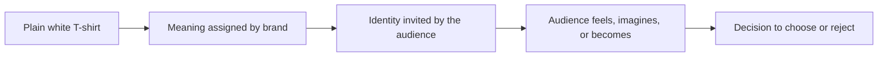

# Chapter 2: Brand Archetypes and the Meaning of a Product

A plain white T-shirt is an unusually good teaching object. It is simple, ordinary, and easy to overlook. Yet the same shirt can become a symbol of rebellion, trust, craftsmanship, simplicity, luxury, or freedom depending on how a brand tells its story.

That is the point of brand archetypes. They are not about reducing people to fixed personality types. They are about recognizing patterns of meaning that repeatedly appear in culture, storytelling, and consumer behavior. A brand does not become a personality diagnosis. It becomes a recognizable emotional and narrative frame.

When a product is positioned effectively, it is not just selling a physical object. It is giving the audience a feeling, a story, an identity, and a reason to imagine themselves differently.

## What is a brand archetype?

A brand archetype is a familiar pattern of meaning that people quickly understand. It helps a company or product feel recognizable, coherent, and emotionally legible.

Archetypes are useful because they organize how people interpret a brand:

- What kind of world does this brand belong to?
- What feeling does it promise?
- What kind of person does it imagine its audience to be?
- What does choosing this brand allow someone to feel, imagine, or become?

The key idea is this: people do not buy products only for utility. They choose products because they also choose the meaning attached to them.

A plain white T-shirt can be framed as:

- a daily essential for the practical person
- a wearable statement for the rebel
- a clean canvas for the creator
- a sign of disciplined premium taste for the ruler
- a quiet expression of care and simplicity for the innocent or caregiver

The shirt stays the same. The emotional meaning changes.

## Archetypes are not rigid categories

It is important to say clearly: archetypes are not literal personality tests. They are models for understanding patterns of meaning.

A person may contain multiple tendencies at once. A brand may also carry several influences. One person can be imaginative and practical, rebellious and caring, ambitious and playful. A brand can be clear and adventurous at the same time. A single product can suggest more than one tone without losing coherence.

This matters because culture shapes how archetypes are read. A symbol or style that feels classic in one context may feel too formal, too literal, or too conventional in another. A quiet, minimalist look may be read as confidence in one culture and as emptiness in another. The same archetype can be expressed differently across communities, eras, and design traditions.

So archetypes are useful as a framework, not as a fixed map of human nature.

## A practical set of common archetypes

Brand archetypes are often discussed as recurring categories. Here are some widely used ones, with simple examples of the meaning they tend to carry:

| Archetype | Core promise | Typical feeling | Common design signal |
| --- | --- | --- | --- |
| Explorer | Discovery, freedom, autonomy | Restless, curious, independent | Travel imagery, open spaces, rugged materials |
| Sage | Wisdom, clarity, truth | Thoughtful, grounded, informed | Simple typography, evidence, calm composition |
| Creator | Innovation, expression, originality | Imaginative, experimental, artistic | Studio-like visuals, process, unfinished energy |
| Ruler | Order, status, confidence | Controlled, premium, established | Strong structure, symmetry, luxury restraint |
| Caregiver | Protection, trust, support | Warm, nurturing, dependable | Soft colors, safety cues, human-centered messaging |
| Rebel | Defiance, authenticity, disruption | Bold, risky, nonconformist | Contrast, rough edges, anti-establishment tone |
| Hero | Progress, courage, achievement | Motivated, disciplined, resilient | Action, momentum, clear challenge and triumph |
| Everyperson | Accessibility, belonging, practicality | Real, honest, relatable | Plain language, everyday scenes, normality |
| Innocent | Purity, optimism, simplicity | Cheerful, sincere, wholesome | Light palettes, natural forms, easy joy |
| Jester | Play, humor, delight | Fun, social, surprising | Wit, irony, expressive shapes |
| Lover | Beauty, intimacy, connection | Sensual, warm, desirable | Rich textures, emotional language, intimacy |
| Magician | Transformation, possibility, vision | Enchanted, visionary, compelling | Mystery, dramatic contrast, symbolic depth |

These categories are not exact science. They are useful narrative shortcuts that help brands communicate clearly.

## The practical question: what does the audience get to feel, imagine, or become?

When choosing an archetype, the key question is not just “What is our product?” It is:

“What does the audience get to feel, imagine, or become by choosing this brand?”

That question is more revealing than a simple slogan. It asks what identity is being offered.

A clothing brand might say:

- “You are a person who values practical comfort.”
- “You are someone with discernment and confidence.”
- “You are creative and not afraid to stand out.”
- “You are part of a community that values honest, everyday experience.”

This is what archetypes do. They convert products into identities.

## The white T-shirt as a story machine

The same white T-shirt can be positioned across several archetypes without any structural change in the garment.

### 1. The Explorer T-shirt

A brand presents the shirt as something for people who move, hike, travel, and live lightly. The message is not about fashion alone. It is about freedom, adaptability, and being ready for the road.

The audience imagines themselves as someone who is open, prepared, and independent. The shirt becomes a companion to actual life, not an ornament for a closet.

This version emphasizes utility, openness, and motion.

### 2. The Creator T-shirt

A brand presents the shirt as a blank canvas, a simple garment that lets personal expression happen around it. The shirt is not the final statement; it is the starting point for something else.

The audience imagines themselves as inventive, experimental, and visually expressive. The shirt becomes a base layer for identity, not a finished identity by itself.

This version emphasizes flexibility and imagination.

### 3. The Ruler T-shirt

A brand presents the shirt as a disciplined, premium essential. It is clean, controlled, and highly intentional. The garment communicates confidence, restraint, and considered taste.

The audience imagines themselves as someone who chooses quality over excess. The shirt becomes a symbol of composure and cultural authority.

This version emphasizes order, clarity, and status.

### 4. The Rebel T-shirt

A brand presents the shirt as a refusal of loud excess. It rejects the idea that identity must be noisy to be visible. The shirt becomes a subtle act of independence.

The audience imagines themselves as someone who is anti-fashion in the best sense: free from trends, more interested in authenticity than approval.

This version emphasizes disruption and nonconformity.

## Comparison table

| Archetype | What the shirt means | What the audience feels | What the brand is promising |
| --- | --- | --- | --- |
| Explorer | Ready for movement and change | Freedom, resilience, independence | Practical adaptability |
| Creator | A canvas for originality | Imaginative, expressive, curious | Self-expression and experimentation |
| Ruler | A refined, intentional essential | Confidence, discipline, control | Quality and authority |
| Rebel | A quiet refusal of trends | Authenticity, independence, edge | Defiance without noise |
| Caregiver | A simple, trustworthy staple | Comfort, safety, sincerity | Steady care and reliability |
| Innocent | A pure, easy, optimistic staple | Calm, openness, joy | Simplicity and honesty |

The same product can support very different narratives because meaning is not attached by fabric alone. It is attached through framing, language, tone, and the identity the audience is invited to inhabit.

## Mermaid diagram

This diagram is useful because it keeps the logic simple. The product is not meaningful by itself. It becomes meaningful through interpretation. That interpretation invites identity, and identity drives preference.

## Archetypes Are Not Destiny

A brand should not confuse archetypes with permanent personality. A company can shift over time. A product line can evolve. A consumer can belong to multiple communities and identities at once.

There are several reasons to be careful:

- Archetypes are simplifications. They help people understand a brand, but they may flatten nuance.
- Audiences are diverse. A person may appreciate a “Ruler” brand while also wanting the warmth of a “Caregiver” brand.
- Cultural context matters. Meaning changes across communities, generations, and styles.
- A product can satisfy more than one archetype at different moments in a customer’s life.

A brand should use archetypes as a creative guide, not as a cage. Good brand work understands both clarity and complexity.

## Questions to Ask When Choosing an Archetype

Before settling on a brand archetype, a designer or strategist should ask:

- What feeling do we want this product to carry?
- What does the audience already believe about this category?
- Which identity does this brand invite, and does it feel real?
- Are we choosing a story that matches the product’s actual value?
- Is the archetype clear enough to be memorable but flexible enough to grow?
- Does the audience see themselves in this role, or are we imposing one on them?
- What happens if the brand is interpreted through a different cultural lens?
- Will this archetype still make sense when the product evolves?

These questions matter because a brand archetype should feel like a useful frame, not a forced personality.

## Why archetypes matter in design

Designers often focus on form, color, typography, and layout. Those are important, but brand meaning lives in connection. An archetype gives a product a recognizable emotional logic.

For example:

- a minimalist layout may support the Sage or Ruler archetype
- raw materials and irregular shapes may support the Rebel or Explorer archetype
- soft texture, gentle imagery, and patient language may support the Caregiver or Innocent archetype
- bold contrast and symbolic visual tension may support the Magician or Hero archetype

This does not mean design is only decoration. It means design is one of the ways a brand makes meaning visible.

## A final note on the T-shirt

A plain white T-shirt can be made to mean many different things, but not all meanings are equally honest or useful. A strong brand archetype is one that genuinely fits the product, the audience, and the experience being offered.

If a shirt is presented as a luxury item but the product is flimsy and the brand story is shallow, the audience will likely feel the mismatch. If a shirt is presented as pure utility but the design language is rich with identity and craft, the brand may feel confused. Good archetypes create coherence.

A brand is strongest when it tells a story the audience can believe in and see themselves inside.

## What You Should Remember

- Brand archetypes are tools for understanding recurring patterns of meaning, not rigid personality labels.
- A product becomes more meaningful when it is attached to an identity the audience wants to inhabit.
- The same plain white T-shirt can represent Explorer, Creator, Ruler, Rebel, Caregiver, or Innocent energy without changing the garment itself.
- Cultural context matters, and brands often contain more than one tendency at the same time.
- The best archetype choice is one that matches the product, the audience, and the values being communicated.
- Design, language, and storytelling work together to make a brand feel recognizable and credible.

A well-chosen archetype does not trap a product in one narrow role. It gives the product a clear emotional center that people can understand and want to belong to.
