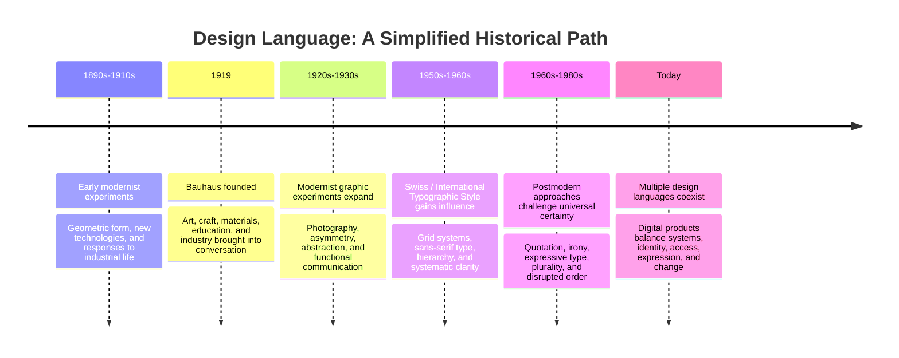

# Chapter 3: Design Language and Visual Ideas

Visual design does more than make information attractive. It tells us what to notice, how to organize what we see, and what kind of attitude a message has. A strict grid can suggest order and reliability. A crowded composition can suggest energy, conflict, or abundance. A typeface can feel official, intimate, playful, or impersonal before we have read every word.

These effects are not universal laws. They are design conventions shaped by history and culture. Studying design history gives us a vocabulary for recognizing those conventions and making deliberate choices.

## A Short Path into Modernism

Modernism in design developed alongside industrialization, new technologies, mass production, and changing ideas about society. Designers increasingly asked how visual communication could serve modern life rather than imitate older decorative styles. The answer was not one look, but a family of experiments involving reduction, structure, function, and new relationships between image and text.

Early modernist designers often explored geometric forms, asymmetrical layouts, photography, and simplified typography. They wanted design to communicate clearly in a world of factories, transportation, public information, and mass audiences. The larger ambition was to develop visual systems that could work beyond one decorative tradition or one historical reference.

This ambition produced useful tools, but it also created a question: can a visual language really be universal? A design that feels clear and neutral to one audience may carry the history, assumptions, or authority of a particular culture to another.

## Bauhaus: Art, Craft, and Industry

The Bauhaus was a school founded in Germany in 1919 that brought together art, craft, architecture, and design education. Its teaching emphasized experimentation with materials, form, color, space, and production. The school is important not because every Bauhaus project looks identical, but because it helped establish a model of design education that connected making, thinking, and practical use.

Bauhaus-related ideas are often simplified into “form follows function” or geometric minimalism. That summary misses the active investigations behind the work. Students and teachers explored how objects and images could be made, how materials behave, and how design might respond to industrial production. The useful lesson for a contemporary designer is to connect visual decisions to purpose, materials, and use rather than treating style as decoration added at the end.

## The Swiss or International Typographic Style

The Swiss Style, also called the International Typographic Style, became especially influential in the mid-twentieth century. It is associated with systematic grids, asymmetrical composition, sans-serif type, strong hierarchy, careful spacing, and photography or simple graphic forms. The grid helps designers align information and create repeatable relationships across a series of pages, posters, or signs.

The style often aims for clarity and consistency. A reader should be able to locate the headline, supporting information, and action without having to decode an ornamental composition. This approach remains visible in wayfinding, editorial systems, corporate identities, dashboards, and digital interfaces.

The grid is not a neutral cage. It is a decision-making tool. It can support access and comprehension, but it can also make a message feel institutional, impersonal, or overconfident. A designer should ask both what the system clarifies and whose experience the system assumes.

## Postmodern Responses

Postmodern design is not one single style, and its history includes many different practices. Broadly, postmodern designers questioned the idea that one restrained, rational, universal visual language could serve everyone. They used quotation, irony, historical references, expressive typography, layered images, unusual scale, and disruption of expected order.

Where modernist design might try to make a system feel timeless, postmodern design might make its references visible. Where a modernist layout might use a consistent grid, a postmodern layout might bend, interrupt, or expose that grid. Where modernist clarity might prioritize one reading path, postmodern expression might allow ambiguity or competing voices.

This does not mean postmodern design is simply “messy,” or that modernist design is emotionless. A carefully ordered design can be expressive, and a chaotic-looking design can still follow a strict underlying system. The important issue is the relationship between a design's rules and the audience's expectations.

## The Tensions Designers Keep Working With

The history is most useful when treated as an ongoing set of questions rather than a contest with one winning side.

| Tension | One direction may emphasize | The other direction may emphasize | Contemporary design question |
| --- | --- | --- | --- |
| Order and disruption | Predictability, scanning, coordination | Surprise, interruption, attention | Where should the interface be stable, and where can it invite discovery? |
| Universality and identity | Shared rules and broad legibility | Local voice, difference, and situated experience | Who is included by a “neutral” visual language, and who is made invisible? |
| Clarity and expression | Fast understanding and low friction | Mood, personality, and interpretation | What must be immediately clear, and what may reward exploration? |
| Grid and anti-grid | Alignment, rhythm, and consistency | Overlap, movement, and unconventional relationships | Does breaking the grid improve meaning or merely add noise? |
| Restraint and abundance | Focus, quiet, and reduction | Richness, accumulation, and sensory energy | How much information can the audience use without becoming overwhelmed? |
| Function and irony | Direct purpose and sincere utility | Commentary, humor, and questioning conventions | Is the joke helping the audience understand the function or obscuring it? |

These tensions appear in ordinary decisions. A health app may need a calm hierarchy for urgent information but use a distinctive identity so it does not feel interchangeable. An online store may use a strict product grid for comparison and an expressive campaign page for storytelling. A public website may need universal access while also acknowledging the identities and experiences of the communities it serves.

## A Timeline of Ideas

This timeline is a simplified map, not a complete history. The movements overlap, and designers did not all agree with the labels later applied to them.

The final entry matters. Design history did not end when one movement replaced another. Contemporary designers borrow, combine, reject, and reinterpret earlier tools. A mobile interface may use a Swiss-like grid, a brand voice shaped by postmodern irony, and an accessibility system grounded in functional clarity.

## How to Read a Design

When looking at a poster, website, package, object, or interface, slow down before deciding whether you like it. Ask what the design is doing.

1. **Start with the situation.** Who made it, for whom, where does it appear, and what action or understanding does it invite?
2. **Map the hierarchy.** What do you see first, second, and third? Is that order created by size, contrast, position, color, motion, or whitespace?
3. **Look for the system.** Are elements aligned to a grid? Are spacing, type, color, and image treatments repeated?
4. **Notice the exceptions.** Where does the design disrupt its own pattern? Does the disruption clarify, emphasize, provoke, or simply decorate?
5. **Read the typography.** Consider scale, weight, width, spacing, and line length. Does the type feel neutral, authoritative, intimate, playful, or confrontational?
6. **Ask what is absent.** Which voices, bodies, histories, or uses are not represented? What information is difficult to find?
7. **Test the experience.** Can people with different abilities, devices, languages, and levels of familiarity use it as intended?
8. **Separate effect from judgment.** Describe the design's choices before deciding whether those choices are successful or ethical.

## The White T-Shirt in Two Visual Languages

Return to the same physical object: a plain white T-shirt with the same fabric, cut, and price.

A **modernist presentation** might place the shirt in a clean, asymmetrical grid with precise measurements, restrained color, a sans-serif type system, and a direct product hierarchy. The message would emphasize function: fit, material, care, and repeatable everyday use. The shirt might feel like a rational, dependable tool.

A **postmodern presentation** might enlarge a detail until it becomes abstract, mix several type styles, interrupt the layout with handwritten notes, and place the shirt beside unexpected cultural references. The message could question the idea that a basic garment has only one correct meaning. The same shirt might feel ironic, expressive, or culturally self-aware.

Neither presentation changes the shirt. Each gives the audience a different way to interpret it. The modernist version makes consistency and utility prominent; the postmodern version makes interpretation and quotation prominent. Both still need accurate information about the product. Visual expression is not permission to misrepresent what someone is buying.

## Contemporary Design: Systems With a Point of View

Digital design makes the old tensions especially visible. A design system may define components, spacing, colors, and interaction rules so that a product remains consistent across screens. That system is useful for speed, accessibility, and maintenance. At the same time, a product needs identity, flexibility, and room to respond to different contexts.

Consider a news site. A clear hierarchy helps readers find urgent information, while expressive typography or illustration can communicate the character of a section. Consider a shopping app. A regular grid supports comparison, while editorial pages can use asymmetry to tell a story. Consider a public service form. Reduction can remove distractions, but excessive reduction can hide explanations that users need.

The best choice depends on the task. “Modernist” and “postmodern” are not buttons that produce good or bad design. They are useful historical lenses for asking what a visual system makes possible, what it discourages, and who gets to feel at home within it.

## Museum Research

To study design history responsibly, look for authentic examples in museum and institutional collections rather than relying only on unsourced image boards or anonymous summaries. Useful places to search include The Metropolitan Museum of Art, MoMA, Cooper Hewitt, the V&A, Bauhaus archives, libraries, university collections, and other credible institutions.

Use search terms such as:

- “early modernist graphic design collection”
- “Bauhaus typography poster archive”
- “Swiss International Typographic Style grid poster”
- “modernist design photography typography museum collection”
- “postmodern graphic design expressive typography collection”

When you find an object, verify the actual record yourself. Check the institution, object title, maker if listed, date, materials, description, and whether the item is being interpreted as an example of a movement or merely connected to it. Do not assume that an image appearing in a search result is authentic, correctly dated, or representative. Compare the institution's description with your own visual observations, and record the collection name so another reader could locate the object without a fabricated URL.

## What You Should Remember

Visual design carries ideas through hierarchy, typography, grids, images, materials, and disruption. Modernist traditions developed tools for function, reduction, and systematic clarity; Bauhaus connected design education with craft, materials, and industry; Swiss Style made grids and typographic systems highly influential. Postmodern approaches questioned universal certainty through plurality, quotation, irony, and expressive disruption. These traditions continue as tensions in contemporary digital and product design. The same white T-shirt can feel functional or ironic because visual language changes how its meaning is organized.