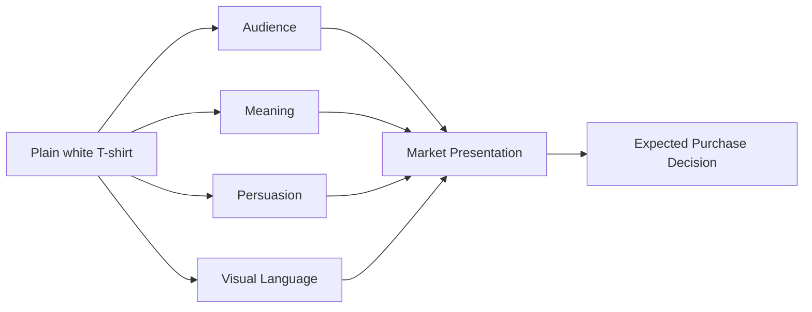

# Chapter 4: The Plain White T-Shirt Case Study

A plain white T-shirt is the most ordinary garment in the room and also one of the most persuasive. It is flexible, familiar, cheap to produce, and surprisingly rich in meaning. A brand can sell the exact same shirt as a tool for adventure, a sign of minimal taste, a weapon of cultural disruption, or a humble daily ritual. The physical product barely changes; the story around it does.

This is where persuasion, archetype, and design language meet. An ordinary T-shirt becomes a marketable idea when the audience feels seen, the meaning feels right, and the visuals make the promise believable.

## 1. The Explorer: “Dress for the Next Unplanned Detour”

### Target audience
- Urban travelers
- Students who want a wardrobe that feels active but not overdesigned
- People who prefer practical basics that still feel adventurous

### Brand archetype
- Explorer

### Persuasive principles
- Adventure framing
- Social proof through lifestyle use
- Authenticity through practical simplicity
- Commitment and consistency, because a traveler may build a “trip-ready” identity one shirt at a time

### Visual language
- Rugged natural colors, weathered textures, hand-drawn maps, field notes, rough edges
- Simple, honest typography with a little worn character
- Product photography in transit: trains, sidewalks, coastlines, backpacks, early-morning city walks

### Headline
- “Built for the road, not the showroom.”

### Short product story
- This shirt is not a fashion statement; it is a dependable companion for spontaneous days. It is designed for people who do not want to overthink what they wear while moving through an unpredictable day.

### Likely imagery
- A white tee draped over a backpack beside a train window, a city map folded into a pocket, a trail path in the background, a person walking between old buildings with a coffee in hand.

### Meaning the customer is invited to buy
- The customer is not just buying cotton and seams. They are buying a version of themselves as curious, capable, and unbothered by rigid rules.

### Ethical concern or possible misuse
- This position can turn everyday practicality into a performance of “authenticity,” which may pressure people to keep buying a certain identity rather than simply wear a shirt they like.

## 2. The Modernist: “Less Noise, More Clarity”

### Target audience
- Creative professionals
- Designers, architects, minimalists, and people who value restraint
- Buyers who think quality is expressed through precision rather than excess

### Brand archetype
- Sage or Caregiver, with a strong modernist edge

### Persuasive principles
- Authority through clarity and craftsmanship
- Framing through simplicity
- Cognitive ease through clean information and confidence
- Reciprocity through useful, honest product details

### Visual language
- Restrained modernist or Swiss-influenced design
- High contrast, precise grid, generous whitespace, disciplined typography, carefully aligned layouts
- Neutral palette: white, stone gray, black, a single accent color only if absolutely necessary

### Headline
- “A white shirt that does not ask for attention.”

### Short product story
- This shirt is made for people who want form to serve function without decoration. The focus is on fit, fabric, proportion, and the quiet confidence that comes from well-made essentials.

### Likely imagery
- A single unadorned shirt centered in a white studio setting, sharply lit shadows, measured composition, clean product close-ups, materials details shown with quiet precision.

### Meaning the customer is invited to buy
- The customer is invited to buy discipline, taste, and a self-image of competence. It says: “I know what matters and I do not need noise to prove it.”

### Ethical concern or possible misuse
- The style can become elitist or moralizing, suggesting that anyone who likes color, texture, or personality is somehow less refined. A minimalist brand must avoid implying that other tastes are inferior.

## 3. The Disruptor: “The Shirt That Refuses to Behave”

### Target audience
- Fashion-conscious young adults
- Cultural trendsetters
- People drawn to art, satire, and postmodern aesthetics

### Brand archetype
- Rebel or Jester, but with a carefully controlled edge

### Persuasive principles
- Contrast and novelty
- Social proof from trend participation
- Emotional arousal through disruption
- Scarcity, when a drop is intentionally limited and well branded

### Visual language
- Disruptive or postmodern
- Off-kilter typography, collage textures, unexpected color accents, abstract layouts, asymmetry, playful contradiction, deliberate visual noise
- A feeling that the shirt is not a neutral garment but a critique of neutrality itself

### Headline
- “The ordinary shirt, deliberately made strange.”

### Short product story
- This shirt is for people who are tired of aesthetic obedience. It begins as a plain white T-shirt and transforms into a visual statement about taste, culture, and the refusal to be boring.

### Likely imagery
- Mixed textures, overlapping type, digital glitches, layered compositions, surreal environment, exaggerated shadows, a model in a staged setting where the shirt is both ordinary and intentionally disruptive.

### Meaning the customer is invited to buy
- The customer is invited to buy distinction, edge, and cultural relevance. The shirt becomes a wearable rejection of “safe taste.”

### Ethical concern or possible misuse
- This concept can slide into shallow outrage or performative rebellion. It may reward attention over substance, encouraging people to buy a personality rather than a product.

## 4. The Everyday Ritual: “The Shirt That Makes a Normal Day Feel Thoughtful”

### Target audience
- Busy professionals
- Caregivers
- People who value comfort, comfort rituals, and a sense of steadiness

### Brand archetype
- Caregiver or Everyperson

### Persuasive principles
- Liking and trust through warmth
- Commitment and consistency through daily use
- Framing the shirt as a reliable companion in ordinary life
- Cognitive ease through familiar messaging and clear value

### Visual language
- Warm, soft, honest, domestic, lightly editorial
- Natural light, soft textures, friendly type, rounded geometry, comfort-focused layouts
- A subtle sense of everyday life rather than spectacle

### Headline
- “The shirt you wear when life is already full.”

### Short product story
- This white T-shirt is not meant to dominate a room. It is meant to show up in the middle of a real week and help make ordinary tasks feel a little more manageable. It is comfortable, easy to live in, and honest about its purpose.

### Likely imagery
- A cup of coffee beside a folded shirt, a person in a kitchen, a morning commute, a home workspace, a soft living room chair, a wardrobe with a few trusted basics.

### Meaning the customer is invited to buy
- The customer is invited to buy calm, order, and the feeling of being put together without effort. The shirt becomes a small but meaningful part of a life that values steadiness over spectacle.

### Ethical concern or possible misuse
- Emotional messaging can become manipulative when it implies the shirt will solve anxiety, identity, or self-worth issues rather than simply provide a useful garment.

## Synthesis Table

| Concept | Target audience | Archetype | Persuasive principles | Visual language | Headline | Meaning being sold | Ethical concern |
| --- | --- | --- | --- | --- | --- | --- | --- |
| Explorer | Travelers, active students, practical adventurers | Explorer | Adventure framing, authenticity, social proof | Weathered, natural, map-like, tactile | “Built for the road, not the showroom.” | Curiosity, movement, capability | Authenticity can become a performance rather than a genuine lifestyle |
| Modernist | Designers, professionals, minimalists | Sage / Caregiver | Clarity, authority, cognitive ease | Swiss-influenced, restrained, grid-based, precise | “A white shirt that does not ask for attention.” | Discipline, taste, competence | Can become elitist or judgmental toward other aesthetic choices |
| Disruptor | Trendsetters, culture-minded consumers | Rebel / Jester | Contrast, novelty, scarcity, social proof | Postmodern, collage, asymmetrical, loud | “The ordinary shirt, deliberately made strange.” | Edge, distinction, cultural relevance | Can turn rebellion into empty attention-seeking |
| Everyday Ritual | Busy professionals, caregivers, practical buyers | Caregiver / Everyperson | Liking, trust, daily consistency, warm framing | Soft, domestic, warm, editorial | “The shirt you wear when life is already full.” | Calm, reliability, emotional steadiness | Can imply the product solves deeper life problems it cannot actually solve |

## How the Pieces Combine

This diagram shows the central idea clearly: the same physical product can be reframed depending on who it is for, what meaning it promises, how it is persuaded, and how it looks. The shirt does not change much. The market story changes everything.

## Why the Same Shirt Can Sell So Many Different Stories

The white T-shirt is a nearly blank canvas. That blankness is the real advantage. It allows a brand to create meaning without changing the product itself. A designer can present it as a practical tool, a moral statement, a cultural symbol, or a comfort object. The important question is never “What is the shirt?” alone. It is “What idea does this shirt carry for this person?”

This is the heart of persuasion in branding. The shirt becomes legible through a mix of audience, archetype, and style. The audience decides the claim. The archetype gives it emotional structure. The design language gives it a believable appearance.

## What You Should Remember

- The same product can be sold through very different meanings when the audience and story change.
- An archetype gives a brand a recognizable emotional promise, such as Explorer, Sage, Rebel, or Caregiver.
- Persuasive principles guide how the message works: urgency, authenticity, clarity, comfort, and belonging are all tools, not moral guarantees.
- Visual language frames the product before the customer even reads the copy. Minimalism, disruption, and warmth are different ways of making the same shirt feel meaningful.
- Good branding does not just sell an object; it sells a version of the buyer’s life.
- Ethical marketing should be honest about what the product can and cannot do, and it should avoid making people feel inferior, manipulated, or pressured into a false identity.

The plain white T-shirt is not empty. It is simply flexible. That flexibility is exactly why it is such a useful case study.
