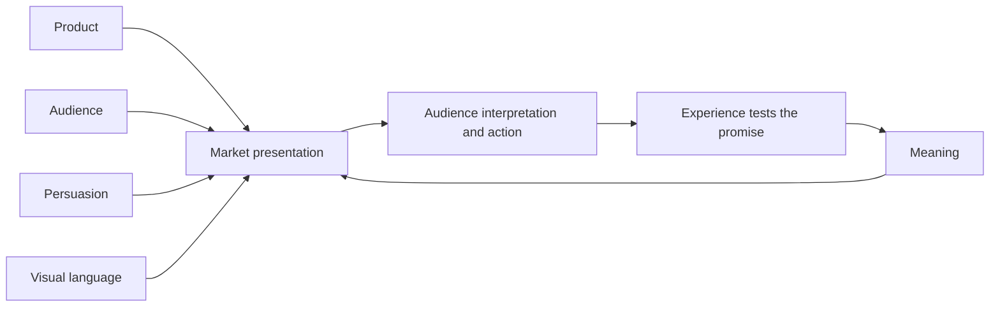

# Chapter 4: One Shirt, Four Stories

Here is the product: an ordinary high-quality plain white T-shirt. It has a comfortable cut, substantial cotton fabric, careful stitching, and a straightforward price. Those are the physical facts we will keep constant.

Now imagine four design teams receiving the same shirt. One team sees a travel companion. Another sees a study in precision. A third sees a provocation. A fourth sees a welcome mat for community. None of the teams changes the shirt substantially. They change the audience, the story, the visual language, and the reasons someone might want it.

That is the central lesson of this case study: a market presentation does not merely display a product. It proposes a meaning around the product. The proposal can be useful and truthful, or it can become pressure, exaggeration, or disguise.

## The Shared Product

Every concept below begins with the same imaginary physical product:

- plain white T-shirt;
- high-quality, medium-weight cotton fabric;
- comfortable everyday cut;
- machine-washable care;
- no printed graphic or visible logo;
- the same basic price, construction, and available sizes.

The shirt is deliberately ordinary. Its lack of a built-in story gives design room to show how meaning is constructed around an object.

## Concept 1: The Explorer's Reliable Layer

**Audience:** People who travel lightly, move between settings, or want clothing that can handle an unplanned day.

**Chosen brand archetype:** Explorer.

**Persuasion principles being used:** Framing, social proof through honest customer experience, and commitment and consistency. The presentation frames the shirt as a useful companion. A customer who values packing lightly can choose it as part of that existing preference rather than being pushed into a new identity.

**Visual-design language:** Open compositions, natural light, maps or route-like lines used sparingly, practical sans-serif type, and photographs that show the shirt in changing contexts. The layout leaves visible space around the model, suggesting room to move.

**Headline:** “Ready for the Day You Did Not Plan.”

**Short product story:** You leave home in the morning expecting one ordinary errand. Then the weather changes, a friend suggests a longer walk, and dinner happens somewhere you have never been. The shirt is not magical equipment. It is simply a dependable layer that works across the day without demanding attention.

**Imagery direction:** Show the same shirt across a sequence of believable situations: folded into a small bag, worn under a jacket, and hanging to dry after washing. Avoid implying that the shirt alone creates adventure.

**What meaning is the customer invited to buy?** The customer is invited to buy readiness and freedom from overplanning. The shirt becomes a quiet companion for movement.

**Ethical concern or possible misuse:** Adventure imagery can make ordinary life look inadequate or make a product appear more technically capable than it is. Claims about durability, odor resistance, drying speed, or travel performance should be made only when they can be supported.

## Concept 2: The Sage Essential

**Audience:** Careful shoppers who want to compare materials, construction, care, and long-term usefulness before buying.

**Chosen brand archetype:** Sage.

**Persuasion principles being used:** Authority, clarity through framing, and reciprocity. The seller provides useful information first: measurements, fabric details, care instructions, and limitations. Relevant expertise can build trust, but the design does not treat an expert label as a substitute for evidence.

**Visual-design language:** Restrained modernist and Swiss-influenced design. Use a precise grid, asymmetrical alignment, a limited color palette, generous spacing, clear sans-serif hierarchy, and documentary product photography. The interface should make comparison easy rather than burying the facts in decoration.

**Headline:** “The Essential, Explained.”

**Short product story:** A basic garment deserves more than vague praise. This page shows how the shirt is cut, what the fabric feels like, how it should be washed, and what the maker does not claim. The appeal is not mystery. It is the relief of knowing what you are choosing.

**Imagery direction:** Use a front view, side view, close-up of stitching, measurement diagram, and a clear care label. Keep the background quiet so the construction remains visible.

**What meaning is the customer invited to buy?** The customer is invited to buy judgment, confidence, and a more deliberate relationship with an everyday object. The shirt becomes evidence that simplicity can be considered rather than careless.

**Ethical concern or possible misuse:** A disciplined grid and technical vocabulary can create an aura of scientific certainty even when the claims are ordinary. Do not use precise-looking charts to exaggerate small differences or hide tradeoffs such as price, care effort, or uncertainty about sourcing.

## Concept 3: The Rebel's Blank Statement

**Audience:** People who enjoy challenging fashion conventions, questioning polished advertising, or using ordinary objects in unexpected ways.

**Chosen brand archetype:** Rebel.

**Persuasion principles being used:** Contrast, liking through a recognizable sense of humor, and controlled disruption. The message invites the audience to notice that a “basic” product is already surrounded by rules about taste and status.

**Visual-design language:** Disruptive and postmodern. Break the expected grid, mix oversized type with handwritten notes, use abrupt cropping, place product facts beside irreverent captions, and let several visual voices compete. The page can look as if a neat fashion advertisement has been interrupted and annotated.

**Headline:** “Nothing to Prove. Plenty to Wear.”

**Short product story:** The shirt refuses to perform a complicated identity on command. It can be worn with expensive pieces, work clothes, borrowed clothes, or whatever was closest to the chair. Its blankness is not a lack of imagination; it is a chance to decide what belongs around it.

**Imagery direction:** Combine a straightforward product photograph with unexpected styling: a formal jacket, paint-marked hands, a stack of laundry, or a deliberately awkward pose. The point is to expose the distance between an ordinary garment and the grand promises often attached to fashion.

**What meaning is the customer invited to buy?** The customer is invited to buy independence from trend pressure and permission to define the combination for themselves. The shirt becomes a small act of refusal.

**Ethical concern or possible misuse:** Rebellion is easy to package and sell back to people as another form of conformity. The brand should not imply that customers are more authentic, intelligent, or morally superior because they bought a white T-shirt. Humor should challenge the category without mocking people who choose other styles.

## Concept 4: The Everyperson Welcome

**Audience:** People looking for comfortable, understandable clothing for work, school, volunteering, family life, or shared events.

**Chosen brand archetype:** Everyperson supported by Caregiver.

**Persuasion principles being used:** Unity, liking, reciprocity, and social proof. The presentation shows real use in ordinary settings, offers clear fit help, and reduces the stress of choosing. Community is an invitation, not a test of loyalty.

**Visual-design language:** Warm documentary photography, plain language, accessible contrast, familiar layouts, and a mix of individual and group images. The design is friendly without pretending that everyone has the same body, budget, culture, or reason for wearing the shirt.

**Headline:** “A Good Place to Start.”

**Short product story:** Some clothes are not meant to announce a transformation. They are meant to let someone get dressed and get on with the day. This shirt is presented as a reliable starting point for many wardrobes and many kinds of ordinary participation.

**Imagery direction:** Photograph people with different ages, body shapes, styling choices, and daily activities. Pair the images with concrete sizing information, fit notes, and an easy way to ask for help.

**What meaning is the customer invited to buy?** The customer is invited to buy belonging without performance. The shirt becomes a shared, flexible starting point rather than a badge of status.

**Ethical concern or possible misuse:** “Everyone” can become a vague marketing word that hides who was actually considered. Inclusive-looking images do not repair inaccessible sizing, confusing returns, or a price that excludes the intended audience. The experience must support the welcome the images promise.

## Comparing the Four Presentations

| Concept | Audience | Archetype | Visual language | Meaning being offered | Main ethical risk |
| --- | --- | --- | --- | --- | --- |
| The Explorer's Reliable Layer | Light travelers and flexible movers | Explorer | Open, documentary, spacious | Readiness and freedom from overplanning | Exaggerated performance or lifestyle pressure |
| The Sage Essential | Careful, information-seeking shoppers | Sage | Restrained modernist / Swiss-influenced | Confidence through understanding | False authority or data theater |
| The Rebel's Blank Statement | Convention-questioning style seekers | Rebel | Disruptive, postmodern, layered | Independence from trend pressure | Selling conformity as rebellion |
| The Everyperson Welcome | People seeking comfort and participation | Everyperson / Caregiver | Warm, accessible, documentary | Belonging without performance | Token inclusion or inaccessible reality |

The table shows why “make it appealing” is not a complete design brief. Appealing to whom? Through what story? With what evidence? The same shirt can be sold as movement, knowledge, refusal, or welcome, and each choice creates different responsibilities.

## How the Presentation Is Built

The parts of a market presentation reinforce one another. If the audience is information-seeking but the page uses only mysterious lifestyle photographs, the visual language contradicts the intended meaning. If a Rebel concept uses a perfectly obedient layout and anxious status language, its promise also becomes hard to believe.

The product is the physical starting point. The audience identifies whose situation matters. Meaning defines what the customer is invited to feel, imagine, or become. Persuasion supplies reasons and attention cues. Visual language gives those choices a recognizable form. The final experience then determines whether the presentation was credible or merely theatrical.

## A Designer's Final Check

Before publishing one of these presentations, ask:

1. Did the physical product stay substantially the same, or did the story quietly invent a different product?
2. Is the audience specific enough that the design can respect its situation without stereotyping it?
3. Which persuasion principles are active, and can the audience recognize the relevant facts?
4. Does the headline promise a feeling or identity that the actual shirt can reasonably support?
5. Does the imagery show a possibility, or does it imply a guarantee?
6. What would a customer be disappointed to discover after buying?
7. Can the customer compare alternatives, understand the price, and decline without shame or confusion?
8. Does the visual language help the message, or is it merely performing a style?

The most persuasive concept is not automatically the loudest one. It is the one whose audience, promise, evidence, and experience fit together.

## What You Should Remember

One ordinary high-quality white T-shirt can support radically different presentations without becoming a different physical product. An Explorer sells readiness, a Sage sells informed simplicity, a Rebel sells independence from trend pressure, and an Everyperson/Caregiver sells belonging and ease. Archetype, persuasion, and visual language work together to create market meaning. Ethical design keeps that meaning connected to what the product really is and what the customer can actually expect.