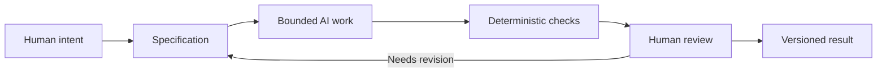

# Chapter 5: Directing Creative Work With Intention

The earlier chapters looked at three ways to think about designed communication:

- **Persuasion** asks: *What response are we trying to enable?*
- **Archetype** asks: *What meaning or identity are we expressing?*
- **Design language** asks: *How should that meaning look and feel?*

Together, these questions form a useful control framework. They do not replace craft, research, or judgment. They help a designer explain what the work is trying to do before choosing words, images, layouts, code, or tools.

## Three Lenses, One Brief

Imagine the plain white T-shirt from Chapter 4. A brief that says “make an ad for a T-shirt” leaves almost everything undecided. A more useful brief might say:

- **Persuasion:** Enable a careful shopper to compare the shirt and decide whether it fits their needs.
- **Archetype:** Express the Sage: thoughtful, transparent, and confident without showing off.
- **Design language:** Use a restrained grid, clear hierarchy, documentary imagery, and accessible product information.

Those choices constrain the work in productive ways. They tell the designer what to emphasize, what to avoid, and how to judge competing ideas. A playful headline, a fake countdown, or a chaotic collage might be interesting in isolation, but they would need a strong reason to belong in this particular brief.

The framework can also produce a different result:

| Lens | Core question | Example answer for the T-shirt |
| --- | --- | --- |
| Persuasion | What response are we trying to enable? | Help someone feel ready to choose with confidence |
| Archetype | What meaning or identity are we expressing? | The Sage: careful understanding and judgment |
| Design language | How should that meaning look and feel? | Restrained, precise, legible, and evidence-led |

The lenses are connected but not interchangeable. A design can use a persuasive technique without having a clear identity. It can have a strong archetype but an incoherent visual language. It can look polished while asking for a response that is unfair or unclear. The framework helps expose those gaps.

## Why Specifications Matter

An AI task should be bounded by a specification. A specification states the intended output, audience, constraints, required elements, and quality checks. It turns a vague request into a problem that can be inspected.

For example, “write something compelling about this shirt” leaves an AI system free to invent a target audience, exaggerate product qualities, or choose a visual mood that does not fit the project. “Write a first-year textbook chapter that compares four truthful presentations of the same shirt, names the audience and archetype for each, includes a Mermaid diagram, and ends with a summary” provides a much clearer boundary.

A good specification does several jobs:

- defines what success includes;
- limits what should be changed;
- identifies facts that must remain true;
- makes omissions easier to notice;
- gives a person or automated check something concrete to verify.

Constraints are not the enemy of creativity. They create a playing field. Once the boundaries are clear, the AI can explore within them and the human can evaluate the results against a shared purpose.

## AI as a Fast but Fallible Collaborator

AI can generate drafts, variations, outlines, code, tables, and alternative framings quickly. That speed is useful during exploration. It is also exactly why the output needs review: fluency can make an unsupported claim sound finished.

An AI system may misunderstand an audience, flatten a cultural context, omit a requirement, or confidently invent a detail. It may satisfy the shape of a request while missing its meaning. The three-lens framework gives the reviewer useful questions:

1. Does the work enable the intended response, or does it pressure the audience toward a different one?
2. Does the archetype express a believable meaning, or is it just a decorative label?
3. Does the design language support the message, audience, access needs, and context?

AI review can also be useful. A second pass can look for missing sections, contradictions, unclear phrasing, or repeated ideas. But AI review is **probabilistic**: it offers a likely judgment, not a guarantee. A polished review can still miss a serious factual or ethical problem. Human review remains necessary.

## Git as Memory and Recovery

Git provides traceability. A commit records a version of the work, the changes made at that point, and the intention described by its message. A branch can isolate an experiment. A diff lets a student inspect what changed instead of relying on memory.

Git also provides recovery. If an AI-generated revision introduces unwanted changes, an earlier version remains available for comparison or restoration. This does not make every change good, and it does not remove the need to read the diff. It makes deliberate experimentation less fragile.

The practical loop is simple:

1. Start from a known version.
2. Make one bounded change.
3. Inspect the diff.
4. Run the relevant checks.
5. Commit a meaningful result.

The commit is not a substitute for thinking. It is a reliable record of what was thought and changed at a particular moment.

## Deterministic Checks and Probabilistic Review

Some questions have repeatable answers. Does the required file exist? Are all five chapter links present? Is there exactly one Mermaid fence? Does a test pass? These are good candidates for **deterministic automated checks**: checks that produce the same result when the same input is tested in the same environment.

Deterministic checks are cheap and repeatable. They catch omissions and structural mistakes quickly, especially after many small edits. They do not understand every nuance of a chapter, but they can protect the basics while a person spends attention on meaning and judgment.

Other questions are interpretive. Is the tone appropriate for a first-year student? Does a metaphor oversimplify a community's experience? Does the visual language feel respectful rather than exploitative? These questions benefit from human reading. An AI can offer another perspective, but its answer remains probabilistic and should be treated as input to judgment, not as a final verdict.

## The Pit-Stop Moment

Think of an automated workflow as a race car that can keep running around the track. It can generate, format, test, and report without getting tired. But selected moments still deserve a pit stop.

At a pit stop, the team does not rebuild the entire car from scratch. It checks the parts that matter for the next lap: the tires, the fuel, the visible damage, and the plan. Human review works similarly. After a meaningful AI change, stop long enough to inspect the diff, read the output as an audience member, verify important facts, and consider consequences the automated checks cannot see.

The point is not to slow every action down. It is to choose inspection points intelligently. Automation can keep running, but humans remain responsible for judgment, meaning, truthfulness, context, and final decisions.

## A Bounded AI Workflow

The workflow is a loop, not a chute. Human intent becomes a specification. The specification gives AI work a boundary. Deterministic checks catch cheap, repeatable failures. Human review examines meaning, truth, context, and quality. Git records the accepted result so the next iteration has a known starting point.

## A Working Checklist

Before asking an AI system to create or change something, write down:

- the purpose and intended audience;
- the response the work should enable;
- the meaning or identity it should express;
- the visual or structural language that fits;
- factual constraints and ethical limits;
- required output files and sections;
- deterministic checks that can catch omissions;
- the human questions that still require judgment.

After the AI responds, inspect the result in that order. First ask whether it is the right work. Then ask whether it is true and appropriate. Finally, check whether it is complete and technically valid. This sequence keeps polish from distracting you from purpose.

## Questions for Next Week

1. Which part of a recent AI task was underspecified, and what boundary would have helped?
2. What response did the work invite, and was that response fair to the audience?
3. What archetype or identity did the work express, intentionally or accidentally?
4. Which visual choices carried the meaning most strongly?
5. What could a deterministic check verify cheaply?
6. What important question could only be answered by a person with context?
7. Where would you schedule the next pit stop before making a larger change?

## What You Should Remember

Persuasion defines the response a design hopes to enable. Archetype defines the meaning or identity it expresses. Design language determines how that meaning looks and feels. In AI-assisted work, a clear specification gives those choices boundaries, deterministic checks catch repeatable failures, Git provides traceability and recovery, and human review protects judgment, truthfulness, context, and responsibility. AI can accelerate the laps, but people still decide where the work is going.